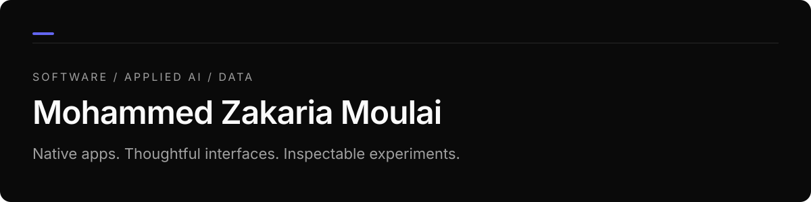

I build native applications, web experiences, and applied AI/data workflows. My projects bring together interface design, practical engineering, and evidence that readers can inspect in the code.

**Swift · TypeScript · Python · React / Next.js · SQL · Azure**

## Selected work

| Project | What I built | Explore |
| --- | --- | --- |
| **Kaddo** | A native macOS study companion with an animated desktop pet, natural-language planner, and local document retrieval. | [Swift application](https://github.com/MohZak-AI/Kaddo) |
| **Caffeinated Web** | A coffee-themed studio website with responsive layouts, booking interactions, consent-aware analytics, and browser checks. | [Source](https://github.com/MohZak-AI/caffeinated-web) · [Website](https://caffienatedweb.com) |
| **Embodied LLM Robustness** | A model-evaluation harness with inspectable prompts, responses, scoring, and archived comparison results. | [Python benchmark](https://github.com/MohZak-AI/llm-embodied-robustness-benchmark) |
| **Olist Customer Satisfaction** | An e-commerce analytics workflow combining classification, model explanations, and regional diagnostics. | [Analysis and models](https://github.com/MohZak-AI/olist-customer-satisfaction) |
| **US Accidents Analytics** | An Azure data workflow for cleaning traffic records and producing partitioned analytics datasets. | [Data engineering](https://github.com/MohZak-AI/us-accidents-analytics) |
| **Titanic Survival Pipeline** | A reproducible classifier with cross-validated model search, held-out evaluation, and prediction artifacts. | [ML pipeline](https://github.com/MohZak-AI/titanic-survival-pipeline) |

## How I approach a project

- Make the interface and setup understandable to someone opening the project for the first time.
- Keep data handling and model-provider boundaries explicit.
- Include reproducible checks and distinguish measured results from design goals.

Additional data workflows: [Amazon Electronics Ingestion](https://github.com/MohZak-AI/amazon-electronics-ingestion) · [Amazon Reviews Data Pipeline](https://github.com/MohZak-AI/amazon-reviews-data-pipeline) · [Fraud Risk Analytics](https://github.com/MohZak-AI/fraud-risk-analytics).
